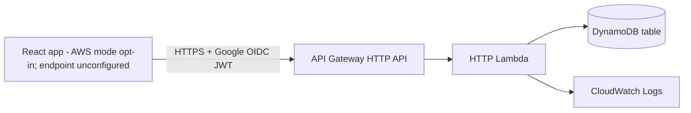

# Ballot AWS Deployment Preparation

**Target region:** `ap-south-1` (Mumbai)
**Status:** Local preparation only. No AWS credentials, account settings, resources, or live services were accessed. No deployment was run.
**Initial deployment scope:** authenticated polls, voting, and results over API Gateway HTTP API only. Live Chat and WebSocket resources/routes are excluded. The React AWS adapter is available as an explicit opt-in, but no deployed endpoint is configured or verified.

## 1. HTTP-only architecture



The current SAM template defines a PAY_PER_REQUEST DynamoDB table with one GSI, server-side encryption, TTL, an authenticated HTTP API with a public health route, one HTTP Lambda and its execution role, and a 14-day Lambda log group. There are no WebSocket APIs, WebSocket Lambdas, connections, chat routes, or chat persistence resources in this initial template. Chat and WebSocket source files and policy examples remain in the repository for later work, but are not invoked by the HTTP handler or deployed by this template.

There is no EC2, RDS, VPC, NAT Gateway, CloudFront, custom domain, frontend hosting, queue, stream, or additional identity provider. Hosting the React frontend and choosing a public HTTPS origin are separate decisions. The frontend now has an explicit `VITE_API_MODE=aws` opt-in. The default remains local; the AWS adapter is not contacted unless that value is set and Google sign-in succeeds.

## 2. Routes in the HTTP-only scaffold

All routes except `GET /health` require a JWT validated by the API Gateway HTTP API authorizer.

| Method and path | Behavior | Access control |
|---|---|---|
| `GET /health` | Returns service health only | Public |
| `GET /polls?view=admin|voter&cursor=...` | Cursor-paginated owner-scoped admin list or published voter discovery; each response includes `nextCursor` when another page exists | Verified JWT; admin view requires allowlisted Google subject |
| `POST /polls` | Create a draft poll | Allowlisted admin subject |
| `GET /polls/{pollId}` | Read permitted poll metadata | Authenticated; drafts only visible to owning allowlisted admin |
| `PATCH /polls/{pollId}` | Edit a draft | Admin allowlist and owner check |
| `DELETE /polls/{pollId}` | Delete an eligible draft | Admin allowlist and owner check |
| `POST /polls/{pollId}/start` | Start poll | Admin allowlist and owner check |
| `POST /polls/{pollId}/close` | Close poll | Admin allowlist and owner check |
| `POST /polls/{pollId}/reopen` | Reopen poll while preserving ballots | Admin allowlist and owner check |
| `GET /polls/{pollId}/votes` | Check whether the signed-in subject voted | Authenticated; poll-scoped pseudonymous key |
| `POST /polls/{pollId}/votes` | Submit single, multiple, or ranked ballot | Authenticated; validated and transactionally stored |
| `GET /polls/{pollId}/results` | Return results when visibility rules permit | Authenticated; Lambda enforces visibility |

There is no chat or WebSocket route in this stage. Live result push is unavailable. Results can be read through HTTP; automatic refresh behavior needs a separate frontend decision and implementation before claiming live updates.

## 3. OIDC, authorization, and voter identity

The HTTP API is configured with Google as the OIDC issuer and a required OAuth Web client ID audience. API Gateway validates JWT signature and standard issuer/audience/time claims. The Lambda uses the validated `sub`; it does not trust request-body roles, `local-admin`, or user-provided identity headers. Admin status is assigned only by the backend `GoogleAdminSubjects` allowlist. The DynamoDB repository additionally checks `ownerSub` for poll management.

Any authenticated Google subject can currently discover polls published to voters and vote. A campus-domain restriction, enrollment/eligibility roster, election-specific eligibility, account recovery, and policy for a voter losing access to their Google account are not implemented. The local username/password session remains separate. In AWS mode, Google Identity Services returns a short-lived ID token held in memory; the frontend sends it as a Bearer token to the HTTP API. API Gateway validates it, and the Lambda `GET /auth/me` route derives the display identity and admin role from verified JWT claims plus `GoogleAdminSubjects`. Frontend roles are never trusted.

Ballot keys are derived as `HMAC(pollId + verified subject)` using the backend-only `VoterKeySecret`. The subject is not stored in the ballot item, but the key remains pseudonymous and linkable within a poll; this is not anonymous voting. Secret rotation needs a versioned migration or could permit repeat ballots. Decide notice, purpose, eligibility, retention, deletion/correction requests, access to poll-level ballot choices, incident handling, and whether publishing poll-level results is acceptable before real voters use the service. Google OIDC does not itself establish administrator status or campus eligibility.

## 3A. Frontend AWS mode configuration

The React app remains local by default. To opt in for local-browser testing against an already deployed API, use these configuration values locally (do not commit real values):

- `VITE_API_MODE=aws` selects the AWS adapter. Omit it or set it to `local` to retain the current Node backend and Vite `/api` proxy.
- `VITE_GOOGLE_CLIENT_ID` is the Google OAuth Web client ID. It must exactly match the SAM `OidcAudience` parameter and the API Gateway JWT audience.
- `VITE_HTTP_API_URL` is the deployed `HttpApiUrl` output, including the `/dev` stage. It is a public endpoint, not a secret.
- `FrontendOrigin` is the exact browser origin allowed by API Gateway CORS. It must match scheme, host, and port; localhost works only on the same machine.
- `GoogleAdminSubjects` is the backend-only comma-separated allowlist of approved Google `sub` IDs. Set it only from a trusted provisioning process; do not infer it from a submitted role, username, or email.
- `OIDC_AUDIENCE` is the Lambda environment value mapped from `OidcAudience`; API Gateway validates the same configured audience before invoking the handler.

The app uses authenticated `GET /auth/me` for role-aware navigation and the owner-scoped `/polls?view=admin` or published `/polls?view=voter` request for list discovery. API Gateway/Lambda remains the authorization boundary for every operation. An HTTP 401 is treated as an expired or rejected Google sign-in and requires sign-in again. There is no token persistence or refresh flow.

AWS mode labels the API as not verified until a deployed environment is separately tested. It does not call the local health endpoint, local backup route, local chat endpoints, or WebSockets. Chat settings are disabled on poll writes in this mode. Local mode retains those features unchanged.

### Values to decide and how to obtain them

| Value | Required configuration | Safe source / action |
|---|---|---|
| Google OAuth Web client ID | `OidcAudience` in SAM and the same value in `VITE_GOOGLE_CLIENT_ID` | In Google Cloud Console, select the intended project, open Google Auth Platform / Clients, create or select an OAuth client of type **Web application**, and copy its client ID. Add the exact frontend origin to Authorized JavaScript origins. For local testing Google documents `http://localhost` and `http://localhost:<port>` origins; for deployment use the actual HTTPS origin. This client ID is public configuration, not a client secret. This app's GIS callback does not need an OAuth client secret or redirect URI. [Google GIS setup](https://developers.google.com/identity/gsi/web/guides/get-google-api-clientid) |
| Frontend origin | `FrontendOrigin` and `VITE_APP_ORIGIN` (where used) | Choose the exact origin including scheme, hostname, and port, e.g. `https://voting.example.edu`; use the same origin in Google Authorized JavaScript origins and API CORS. Do not use a localhost origin for users on other machines. |
| Admin subject allowlist | `GoogleAdminSubjects`, comma-separated Google `sub` values | Google Cloud Console does not provide an admin subject roster. Each intended administrator must complete Google sign-in, and the `sub` must be taken from a trusted backend response after that backend verifies the Google token. In local Google mode, use the authenticated `/api/auth/me` response; in an AWS test deployment, use `/auth/me`. Both expose the verified subject. Do not use email or username as the allowlist key. A missing subject should remain a voter. Treat the IDs as personal data and protect the provisioning record. [Google OIDC claims](https://developers.google.com/identity/openid-connect/reference) |
| SSM parameter name | `VoterKeyParameterName` | Choose a hierarchical name beginning with `/`, for example `/ballot/<environment>/voter-key`. This name is not secret. The parameter must be a pre-created Standard `SecureString` in `ap-south-1`, encrypted with the AWS-managed `aws/ssm` key. Its value must be a cryptographically random key of at least 32 bytes and must remain stable. No secret value is a SAM parameter. |

Before deployment, create the parameter manually through an approved secure process in `ap-south-1`: use Parameter Store, tier `Standard`, type `SecureString`, and the AWS-managed KMS key `aws/ssm`. Enter the generated key in the console value field; never put it in a command, stack parameter, template, source, or logs. Keep this key stable; rotation requires a voter-key migration to avoid duplicate-vote bypass. The template accepts only the nonsecret parameter name. At Lambda initialization, the function calls `GetParameter` with decryption enabled and caches the validated value in memory; retrieval failures fail closed with a generic error and no secret logging.

Do not include real IDs or secrets in this guide or source control. `.env` and `.env.*` are ignored by the repository, but local files still need OS/user access protection. Keep only placeholders in `.env.example`.

## 4. DynamoDB, ballots, results, and ranked choice

The one-table design uses `PK`/`SK` and sparse `GSI1` keys. Polls are keyed by poll ID; owner and voter discovery use GSI partitions; ballots are poll-scoped and partitioned into vote shards; result counters use separate result shards. The design document remains the detailed source for item shapes. Chat, connection, and ticket item shapes in that design are future-only for this HTTP-only deployment.

Each accepted ballot uses a DynamoDB transaction that checks the poll is active and unexpired, conditionally inserts the deterministic poll/voter ballot, and updates counters atomically. The conditional ballot key prevents concurrent repeat submissions. Results are calculated on the server; client totals are ignored. Visibility rules are enforced in the repository. Single and multiple-choice percentages use integer counts from configured result shards.

**Ranked-choice status:** Instant-Runoff Voting is implemented in both local and AWS repository code and covered by local/mock tests; it has not been verified against deployed AWS. Ballots may be partial rankings with at least one unique valid option. Each round assigns a ballot to its highest remaining candidate, reports exhausted ballots, and uses a strict majority of continuing ballots. A uniquely lowest candidate is eliminated. A tie for lowest ends the count with no winner; no arbitrary tie-break is applied. Ranked results reread stored ballots and recalculate rounds per request, so read cost and latency grow with ballot volume. The prior guide statement that ranked choice was disabled is stale and corrected here.

### DynamoDB transaction permissions

The HTTP role now grants `GetItem` on the table and `Query` on the table and discovery GSI. It grants `ConditionCheckItem`, `PutItem`, `UpdateItem`, and `DeleteItem` only on the table and only when `dynamodb:EnclosingOperation` is `TransactWriteItems`. This matches the repository's transaction actions while preventing those write permissions from being used as standalone item operations. The obsolete `execute-api:ManageConnections` permission has been removed from the HTTP role. The standalone example policy in `aws/policies/http-function-policy.json` matches this scope. The WebSocket role and policy examples remain outside the initial template.

This is local policy-code review and test coverage, not SAM or live AWS validation. AWS documents transaction authorization through the underlying item actions and the `ConditionCheckItem` permission, with `TransactWriteItems` usable as the enclosing-operation condition. See [DynamoDB transaction IAM authorization](https://docs.aws.amazon.com/amazondynamodb/latest/developerguide/transaction-apis-iam.html) and the [DynamoDB service authorization reference](https://docs.aws.amazon.com/service-authorization/latest/reference/list_amazondynamodb.html). The same Lambda role grants `ssm:GetParameter` only on the ARN constructed from `VoterKeyParameterName`. `kms:Decrypt` uses `Resource: "*"` because the AWS-managed `aws/ssm` key ARN is account-managed, but is constrained with `kms:ViaService` for SSM in the deployment region and the exact `PARAMETER_ARN` encryption context. This is a local policy configuration; the key and parameter must be provisioned separately and no live permission has been changed.
## 5. Retention and cost risks

The table deliberately has both `DeletionPolicy: Retain` and `UpdateReplacePolicy: Retain`. Removing a stack or replacing the table would leave the table and its stored data behind; table storage can continue to incur charges until the retained table is separately deleted. TTL is not a general poll/ballot cleanup policy and deletion is asynchronous. No deletion protection or data lifecycle schedule is configured. Do not remove retention protections without a separate data-retention and recovery decision.

The voter-key parameter uses Parameter Store Standard SecureString with the AWS-managed `aws/ssm` key; AWS currently lists standard parameter storage and AWS-managed key use as having no additional charge ([Parameter Store tiers](https://docs.aws.amazon.com/systems-manager/latest/userguide/systems-manager-parameter-store.html), [SecureString encryption](https://docs.aws.amazon.com/systems-manager/latest/userguide/secure-string-parameter-kms-encryption.html)). Advanced tiers, high-throughput options, or customer-managed KMS keys can add costs. The Parameter Store parameter is managed outside this template, and any service use may still carry billing implications; ₹0 is not guaranteed. PAY_PER_REQUEST avoids idle provisioned read/write capacity charges, but requests, transactions, GSI reads/writes, and stored bytes may still cost money. Other possible charges include API Gateway requests, Lambda duration/requests, CloudWatch log ingestion/storage beyond allowances, and data transfer. Initial HTTP-only scope avoids WebSocket connection-minute/message charges; adding chat/push later adds those costs. Google OAuth itself may have its own account and policy requirements. AWS free-tier eligibility and credits depend on account status, dates, and service usage; they do not guarantee ₹0. No billing or credits were inspected. The target of ₹0 out-of-pocket cannot be guaranteed. Check the official [API Gateway](https://aws.amazon.com/api-gateway/pricing/), [Lambda](https://aws.amazon.com/lambda/pricing/), [DynamoDB](https://aws.amazon.com/dynamodb/pricing/), and [CloudWatch](https://aws.amazon.com/cloudwatch/pricing/) pricing pages and set a budget/alerts before any approved resource creation; alerts do not cap charges.

The DynamoDB table is retained even if the stack is removed. Cleanup must include a separately approved review and deletion of the retained table if stopping storage charges is intended. No cleanup command should be run without confirming the exact table and backup status.

## 6. Local development and validation

The current local React + Node backend remains the default and its workflow is unchanged. The React AWS HTTP adapter is implemented and explicitly opt-in with `VITE_API_MODE=aws`; it sends the Google Identity Services ID token as a Bearer token and calls authenticated `/auth/me` before role-based navigation. No deployed endpoint or Google client configuration is included in the repository, so this does not mean the application is connected to or verified against AWS. Local AWS handler/repository tests inject mocked clients and do not contact AWS. AWS poll-list calls follow `nextCursor` for both voter discovery and owner-scoped Admin listing; the Admin dashboard totals are computed across all owner polls on the initial page and are not recalculated on subsequent cursor requests.

From `C:\Users\bapna\voting-system`, the local checks are:

```powershell
npm.cmd test
npm.cmd --prefix aws test
npm.cmd run lint
npm.cmd run build
```

Record the actual local test, lint, build, SAM validation, and SAM build results for each validation run; passing local checks do not validate a deployed AWS environment. AWS SDK dependencies are present under `aws/node_modules`. SAM CLI may be installed outside the current shell PATH; use `Get-Command sam -All`, `where.exe sam`, and, if necessary, invoke the known installation wrapper by its full path to check its version. No deployment or AWS operation is part of local validation.

## 7. Remaining blockers before using AWS mode or deploying

1. Confirm the approved Google OAuth Web client ID and exact frontend origin. Configure the web client's Authorized JavaScript origins and use the same client ID as both `OidcAudience` and `VITE_GOOGLE_CLIENT_ID`; use the matching origin for `FrontendOrigin`/CORS. Do not create or share a client secret for this browser ID-token flow.
2. Provision `GoogleAdminSubjects` from verified backend `/auth/me` identities for the specifically approved administrators. The frontend selector, username, email, and request role are not authorization sources.
3. Create the approved Standard SecureString parameter in `ap-south-1` outside this template, encrypted with `aws/ssm`; set only its parameter name as `VoterKeyParameterName` during deployment. Restrict parameter access, keep the HMAC value stable, and never put it in CLI arguments or Git.
4. Decide voter eligibility, privacy notice, ballot retention/deletion, result disclosure, and account/incident processes. Currently any authenticated Google subject can discover published polls and vote; no campus roster/eligibility gate exists.
5. Start the AWS deployment with a fresh, empty DynamoDB dataset as approved. Existing local polls, votes, accounts, and sessions remain in the local development environment and are not migrated or deleted; they will not appear in AWS. Keep the local backend as the default and do not reset or restart it as part of deployment.
6. The latest offline SAM build succeeded after the approved retrieval of the exact locked `@aws-sdk/client-ssm@3.1156.0` tarball and its addition to the local npm cache. Its SHA-512 integrity was verified against `aws/package-lock.json`, and npm was kept offline during the successful build. This confirms local packaging only; it does not verify deployment or runtime behavior in AWS.
7. Before approving deployment, select the stack name and an approved artifact bucket. The template does not create that S3 bucket; avoid `--resolve-s3` unless its possible bucket creation is separately reviewed and approved. Specify `--region ap-south-1` explicitly because the template does not enforce a region. Review the change set and exact deployment permissions first.
8. After a separately approved deployment, test Google token acceptance/rejection, CORS, voter discovery, allowlisted-admin operations, owner isolation, duplicate/concurrent vote rejection, result visibility, and ranked-choice rounds against the deployed stack. Token refresh is not implemented; reauthentication is required after expiry. Do not call the AWS mode operational until these checks pass.
9. Keep Live Chat and WebSocket delivery excluded. Review expected traffic and current service pricing before resource creation; there is no way to guarantee ₹0 cost.

## 8. Approval boundary

This document and template are local preparation only. Before any resource-creating operation, obtain explicit approval for the exact plan, account/region, resource list, expected cost exposure, and cleanup procedure. Do not deploy merely because local tests pass. No AWS operation has been performed or validated.
